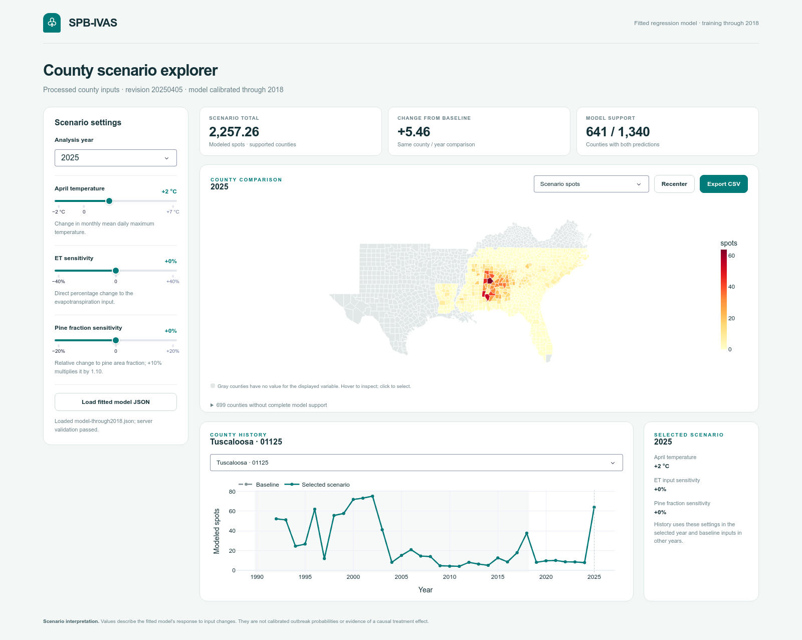

# SPB-IVAS

The Southern Pine Beetle Interactive Visualization and Analysis System fits a county-level regression to infestation history, climate, evapotranspiration (ET) and forest inventory. The web interface and command line use the same saved calibration. Version **1.0.0-rc.1** accompanies the SoftwareX manuscript by Bo Song, Thomas M Williams, Brian Williams and Shaowu Bao.

## Run the 2025 county case

Use **SPB-IVAS-20250405-processed.zip** for the paper’s main demonstration. It contains the real processed county tables, the 1,340-county map and the model fitted through 2018. Place the case ZIP alongside this README. Each case includes SHA-256 checksums and expected results. The Zenodo version identifier for the software and both cases is [10.5281/zenodo.24352449](https://doi.org/10.5281/zenodo.24352449).

Install with Python 3.9 (tested with 3.9.18 on Linux), extract the case, and start the app.

```bash
python -m venv .venv
source .venv/bin/activate
python -m pip install -r release/requirements.txt
unzip SPB-IVAS-20250405-processed.zip
python release/serve_web.py --data-dir case-20250405 --revision 20250405 \
    --model case-20250405/model.json
```

Open the [local dashboard](http://127.0.0.1:8050). Select 2025 and a county, change April maximum temperature or seasonal ET, and download the comparison. The input revision supports predictions in 641 of 1,340 counties. Their baseline estimates sum to **2,251.798 modeled spots**. Raising April maximum temperature by 2 °C at fixed ET raises the sum to **2,257.262**. These are retrospective scenario estimates.



### Refit and verify

```bash
python release/run_spbom.py fit --data-dir case-20250405 --revision 20250405 \
    --through-year 2018 --output outputs/model-2025.json
python release/run_spbom.py predict --data-dir case-20250405 --revision 20250405 \
    --model outputs/model-2025.json --year 2025 --output outputs/baseline.csv
python release/run_spbom.py predict --data-dir case-20250405 --revision 20250405 \
    --model outputs/model-2025.json --year 2025 --tmax 2 --output outputs/warm.csv
python scripts/verify_example.py --data-dir case-20250405 --revision 20250405 \
    --through-year 2018 --year 2025
```

The April maximum temperatures in the supplied provisional climate file identify the 2025 revision used in the paper. Its SHA-256 starts with `0506c360`. The file manifest identifies all six inputs. To see duplicate keys, conflicts, precedence and missing values, run `python release/run_spbom.py audit --data-dir case-20250405 --revision 20250405 --output outputs/audit.json`.

### Repeat for 2026

Extract **SPB-IVAS-20260406-processed.zip**. Use `--data-dir case-20260406 --revision 20260406 --model case-20260406/model.json` to launch the app. The baseline for 2026 supports 549 of 1,340 counties and sums to **1,590.696 modeled spots**. Each case runs offline after installing the software and obtaining the processed ZIP.

## Prepared inputs

File names below use REV for an input revision, such as 20250101. County FIPS codes are preserved as five-character strings. YEAR is the calendar year and MONTH runs from 1 to 12.

| File | Fields used by the fitted example |
|---|---|
| prism_stable_REV.csv | FIPS, YEAR, MONTH, TMAX_C (°C) and PPT_MM (monthly mm). TAVG_C and TMIN_C are recognized climate fields. |
| prism_provisional_REV.csv, optional | The same monthly fields. An empty table with headers is supported. Stable PRISM takes precedence over provisional fields. |
| cpc_REV.csv, optional | County climate updates such as PPT_4 or TMEAN_4. Only matching fields are updated. A mean temperature cannot supply April maximum temperature. |
| wassi_REV_p0.csv or wassi_REV.csv | FIPS, YEAR, MONTH, ET (monthly mm). The model uses mean monthly ET for March–October. |
| fia_REV.csv | FIPS, YEAR, PINE_ACRES (acres), PINE_DENSITY (pine-area fraction), STD_1 (source inventory fraction). The supplied research extract does not document the original FIA code for STD_1. |
| spots_REV.csv | FIPS, YEAR, SPOTS (observed nonnegative integer). Recorded zeros and missing counts have different meanings. |

Both interfaces export the model fingerprint, input-manifest fingerprint, revision and applied adjustments. To compare files, match these fingerprints along with county and year. The prediction CSV reports mean monthly seasonal ET in `ET_mm_per_month` and retains the historical column spelling `Evap_Transporation` as an alias.

The input audit identifies file hashes, overlaps, conflicts, invalid values and missing coverage. Identical duplicates collapse. Conflicting observations at a key are withheld and recorded. Forest measurements carry forward only from the same county. A missing previous-calendar-year count or required predictor leaves a missing prediction with a reason. Both ET and precipitation seasonal summaries require eight monthly values. The model keeps the county prediction when only display precipitation is unavailable.

## Reading a scenario

The fitted file stores the annual calibration cutoff, selected features, OLS coefficients, Box–Cox parameter, centering and scaling statistics, relative-class thresholds, and training provenance. Scenarios use that saved state. Temperature adjustments are additive in °C; ET and pine fraction adjustments are relative percentages. The latter changes a regression covariate while holding reporting acres fixed. An ET adjustment acts directly on mean seasonal ET. The app does not simulate a rainfall change or recompute watershed hydrology during a request.

## Source, tests and historical verification

The supported county workflow is in `release/`. Calibration and inference are in `fitted.py`, preparation is in `prepared.py`, and Dash callbacks are in `scenario_web.py`. Each processed case supplies the ET consumed by this workflow.

```bash
python -m pip install pytest==8.3.5
python -m pytest -q tests
```

A small generated, twelve-county fixture under `examples/demo/` exercises the same code during testing. `python scripts/verify_example.py` runs this fixture without the historical downloads. The [earlier OLS and Dash code](legacy/README.md) records the historical implementation.

For a separate reconstruction of the 2026 county ET input, users with the historical WaSSI Fortran source, forcing and watershed configuration can run `python scripts/check_wassi_et.py --fortran-dir PATH_TO_WASSI_CODES --model-dir PATH_TO_PREPARED_WASSI_WORKSPACE`. WaSSI computes monthly watershed ET before streamflow routing. The county cases need only the prepared ET. [US Forest Service WaSSI](https://research.fs.usda.gov/srs/products/dataandtools/water-supply-stress-index-wassi)

The authors’ source uses the MIT License. The processed cases identify the source datasets in their case documentation. Those data and the software dependencies retain their respective terms. [Licence.txt](Licence.txt) · [Software citation](CITATION.cff)

The earlier operational SPB-IVAS dashboard is available on the web. The source and instructions above run the version described in the paper. [Operational web application](https://spb.digiapp.org/)
